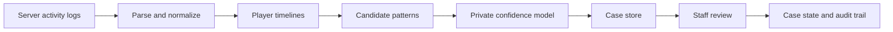

# SpawnSet Dupe Detector

**DayZ activity analysis · event correlation · moderation case workflows**

> **Private-source case study, not a runnable detector.** This repository contains a deliberately limited interface, high-level technical documentation and synthetic examples. No production heuristics, staff data, credentials or moderation thresholds are provided.

## The problem

Game-server staff need to investigate unusual patterns of item creation, player deaths and related events without manually comparing hundreds of log entries. Single events are rarely enough context: investigation requires timelines, relationships, recurring patterns and a traceable record of the review.

This project documents the design of a DayZ activity-analysis and case-management subsystem developed for a private community automation platform.

## Processing pipeline

| Component | Responsibility | Technical concern |
|---|---|---|
| Ingestion | Read activity batches and recognize event families | Malformed records, repeated input, backfill |
| Normalization | Extract useful identifiers and timestamps | Parsing, ordering and missing fields |
| Analysis | Examine time windows, relationships and event sequences | Correlation, false positives, explainability |
| Case lifecycle | Open, update and review investigation records | State transitions and persisted context |
| Staff integration | Surface relevant evidence without flooding channels | Alert deduplication, permissions and audit trails |

The precise detection formulas, thresholds and operational adapters are intentionally private.

## Evidence from reviewed source

A user-provided private DeadCity source snapshot was reviewed on **16 November 2026**. Its `services/spawnset_dupe/` area separated parsing, analysis, models, storage and case handling. A related test suite in `tests_spawnset_dupe/` contained **27 tests, all passing locally** at the time of review.

**Scope:** this verifies one subsystem in the supplied archive. It does **not** prove the public repository is deployable, establish production uptime, or assert full end-to-end coverage.

## Public repository map

- [Architecture and data flow](docs/ARCHITECTURE.md)
- [Engineering case study](docs/CASE_STUDY.md)
- [Interface contract](src/public_interface.py) — intentionally raises `NotImplementedError`
- [Illustrative config shape](examples/config.example.jsonc) — example only
- [Publication boundary](NOTICE.md) and [security policy](SECURITY.md)

## What an employer can evaluate

The architecture discusses temporal event processing, failure modes, stateful case review and verification strategy. For runnable Python implementation and automated CI, see the separate [synthetic ticket-workflow backend demo](https://github.com/Scumbagsss/advanced-discord-ticket-bot).

## Limitations

The private implementation is not available for independent review. Synthetic examples are not real-player evidence. An automated alert is a signal for human investigation—not proof of misconduct.

**Author:** [Scumbagsss](https://github.com/Scumbagsss) · Python backend / automation
