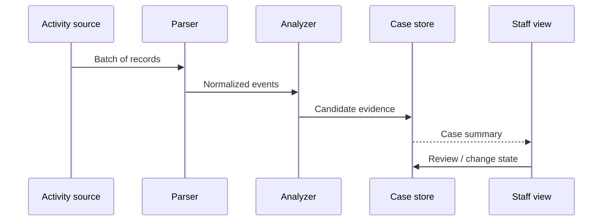

# Architecture — activity investigation

## Scope and trust boundary

This document describes the **conceptual architecture** of a private moderation subsystem. Public code intentionally excludes the proprietary rule engine, scoring parameters and server adapters. The interface in `src/public_interface.py` is an architectural sketch, **not** an implementation.

## Layers

1. **Ingestion & parsing:** consume server log batches and translate them into normalized events. Avoid treating raw text as a stable schema.
2. **Timeline construction:** order events by time and subject. Keep enough source context for staff to trace an alert back to its origin.
3. **Candidate analysis:** inspect related events in configurable time windows. Correlation is evidence for investigation, not an automatic verdict.
4. **Private confidence model:** attach contextual scoring and explanatory evidence to a case. Thresholds and actual algorithms remain private.
5. **Case persistence:** store case state, review history and references in a database.
6. **Discord/staff adapter:** present actionable summaries and updates without revealing sensitive logs to unauthorized users.

## Failure and quality considerations

- **Duplicate batches:** a retry or backfill should not create multiple identical cases.
- **Out-of-order timestamps:** compare normalized event times, not arrival order alone.
- **Missing identifiers:** preserve uncertainty instead of inventing associations.
- **False positives:** keep manual review as a deliberate part of the workflow.
- **Sensitive evidence:** minimize storage and redact player identifiers in demonstrations.
- **Restart recovery:** processing cursors and review state need a durable representation.

## Verification

A private source archive reviewed on 16 November 2026 included a distinct `services/spawnset_dupe/` package and 27 tests under `tests_spawnset_dupe/`; all 27 passed in a local run. This is evidence about the reviewed archive, **not** a test result for the public skeleton.

## Public/private separation

Public: system boundaries, problem statement, conceptual flow, non-runnable interface and synthetic examples.

Private: production parsers, thresholds, detector rules, database schema, operational secrets, Discord identifiers and real game logs.
